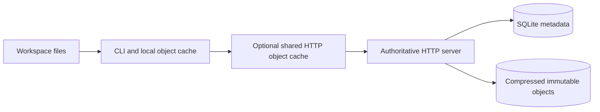

# Architecture

OpenSCN separates workspace files, immutable content, and mutable shared refs.
The implementation is deliberately small enough to inspect and run locally.
It independently explores ideas discussed in
[Anthropic's source control article](https://www.anthropic.com/engineering/redesigning-source-control).
The article describes a separate system; it is not a specification of this code.

## Immutable content and mutable names

The authoritative store uses SHA-256 content identifiers, compressed objects on
disk, and SQLite metadata. Blobs hold file bytes. Trees recursively map names
to child trees or blobs; blob entries include the executable bit. Changesets
record parents, a path-to-change map, message, author, timestamp, and root tree.
Each change is a file replacement or a deletion; parents express history.
Identical immutable content is shared between revisions.

Changeset identity hashes its parents, delta, and metadata, excluding the tree
root. The root is eagerly derived and stored alongside that immutable payload.
Committing rewrites the directory objects along affected paths, reusing other
subtrees; it does not enumerate every file in the repository. Blob and tree
hashes include separate type prefixes to prevent cross-type ambiguity.

References map human-readable names to changeset IDs. A ref update requires
an explicit expected value. A stale writer gets an error rather than silently
replacing another writer's update. Creating a changeset does not mutate a ref.
The server and CLI's `land` also check ancestry before moving a reference. Object upload
can precede a failed metadata operation, leaving unreferenced objects; this
version has no garbage collector.

## Workspaces and sparse reads

A workspace records its server, base revision, sparse selection, and local
state in `.openscn/`. It contains ordinary files usable by existing editors and
tools. The client traverses tree objects for selected paths, fetches their
blobs, and caches immutable objects on disk. Workspaces do not contain a full
local copy of repository history. Operations requiring history or refs need
the server.

Sparse selection affects materialization, not the meaning of the complete
changeset tree. Committing selected files preserves paths outside the selection.
Updates reject dirty workspaces. Path validation and rejection of symlink
traversal protect the workspace boundary. There is no virtual filesystem:
selected files are eagerly written to disk during checkout.

Mutations acquire a POSIX workspace lock and reload metadata under that lock.
Checkout stages verified blobs individually on disk, rechecks the worktree after
fetching, and writes a journal before installing files. `openscn recover`
continues interrupted operations from staging without network access and refuses
conflicting pending edits. File payload memory is bounded by the largest blob;
the file manifest and journal remain in memory. Staging requires additional disk
space proportional to changed contents. See [operations](operations.md).

## Cache tiers

Clients can talk directly to the primary server or through an HTTP cache.
Cacheable endpoints identify immutable blobs and trees by content hash.
Metadata, reference lookups, and writes pass through to the upstream server.
Disk caches are bounded and evict objects; they are optional and recoverable.
An upstream may itself be another cache, allowing several tiers using the same
HTTP protocol. This is not metadata replication or offline operation.

Concurrent misses for one object share an in-flight result, even when disk
caching is disabled. A local cache disk failure permits verified upstream reads.
Each cache bounds concurrent upstream requests and temporarily opens a circuit
after repeated network, server, or object-integrity failures; one probe checks
recovery after the cooldown. Hot objects do not need upstream access. A tier
never bypasses its configured upstream, and HTTP handler concurrency is bounded.

## History operations

The changeset graph supports multiple parents and finding a common ancestor.
Merge compares base, left, and right file entries. A change on one side is
accepted; matching changes agree; competing file-level changes conflict.
Rebase replays one changeset's delta onto another revision. It does not replay
an arbitrary stack. Log follows first parents, and blame attributes lines
using server-side history. These semantics are intentionally smaller than
those of mature distributed source control systems.

Versioned derived-data recipes persist JSON results keyed by changeset and
optional query key. Recipes compute from parent results using an explicit stack,
so backfilling long histories does not depend on Python's recursion limit.
Graph generation numbers and first-parent binary-lifting pointers are computed
eagerly. Path-touch indexes select candidate history entries; graph queries
filter out other branches. Blame is computed lazily through relevant touches and
reused after restart. Derived data can be discarded and rebuilt without changing
changeset identities or refs. These queries remain server-side implementation
details; clients continue using HTTP v1.

Diff compares Merkle trees and avoids visiting equal subtrees. First-parent
ancestor lookup takes logarithmically many indexed graph reads after backfill.
General DAG ancestry still traverses the graph with generation pruning; merge
still materializes file manifests. No claim is made that all queries are
incremental or logarithmic.

## Operational boundaries

One server owns one data directory. SQLite and a local filesystem are the
authoritative storage backend. A shared bearer token provides coarse access
control; author strings are user-supplied metadata, not verified identities.
The HTTP server is a prototype, without TLS termination, multi-tenant quotas,
fine-grained authorization, a horizontally scaled metadata layer, or automatic
backup management. Deployment behind a proxy does not remove these limits.

Correctness tests and the API demonstration exercise supported behavior. They
do not establish enterprise scale, production reliability, or performance
equivalence with another implementation.

## Development priorities

Before treating OpenSCN as production source control, the next work includes:

1. Broader crash/power-loss testing and tested backup/restore tooling.
2. Bounded metadata and single-object streaming, more scalable merge-base/merge
   queries, and measurements on much larger histories and real workloads.
3. Per-user authentication, repository/path authorization, audit events,
   quotas, and deployment hardening.
4. A distributed metadata/object backend and fault-injection tests before
   making horizontal scalability or availability claims.
5. Richer merge handling, Git interoperability, and optional on-demand file
   materialization. Current merges deliberately report conflicts at file level.

These are future work, not features of the initial release.
